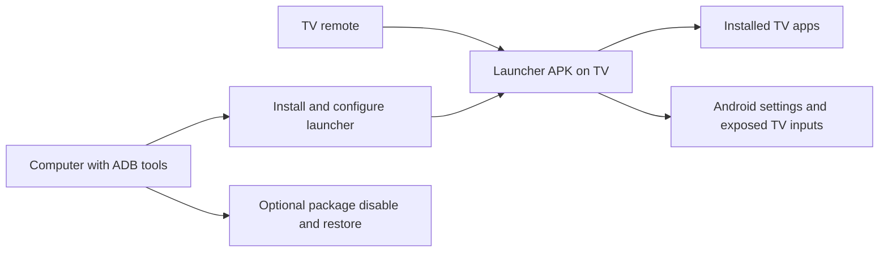

# Open TV research

Reviewed on 20 October 2026. This is a source and documentation review, not a device compatibility test or a performance benchmark. The local Open-TV directory was empty before this document was created.

This document preserves the initial source review. The later selected scope is an open-source Android TV / Google TV home-screen replacement, with Xiaomi MiTV-MOOR0 on Android 11 as the first prototype test device. See README.md for current implementation status; recommendations below describe the initial evaluation.

**What Claude-TV builds**

[Claude-TV](https://github.com/vishalsingh2972/Claude-TV) combines a native Android launcher with computer-side tools for administering a TV. Its home screen has a favorites dock, an app grid, clock, input switching, network status, and Settings shortcuts. Optional package lists help disable unwanted manufacturer software. It does not integrate an AI assistant, provide a streaming catalog, or remove advertising inside other apps.

There are two separately useful parts:

The computer tools handle installation and maintenance. The installed launcher runs without a continuous connection to the computer. Package disabling is optional; it need not be part of the first version.

**What the code actually does**

| Source reviewed | Implementation and implication |
| --- | --- |
| [AndroidManifest.xml](https://github.com/vishalsingh2972/Claude-TV/blob/main/launcher/app/src/main/AndroidManifest.xml) | Registers a HOME activity and a DreamService screensaver. There is no Internet permission. Location permission is requested to display the Wi-Fi network name. |
| [MainActivity.java](https://github.com/vishalsingh2972/Claude-TV/blob/main/launcher/app/src/main/java/com/gathin/tvhome/MainActivity.java) | Owns the screen, D-pad movement, focus animations, network label, and TV input popup. Last-focused app is stored in static fields, so it survives activity recreation but not process death. |
| [AppAdapter.java](https://github.com/vishalsingh2972/Claude-TV/blob/main/launcher/app/src/main/java/com/gathin/tvhome/AppAdapter.java) | Discovers activities declaring LEANBACK_LAUNCHER, sorts favorites before other apps, and opens them using explicit intents. Phone-only apps are not included by this discovery method. |
| [config.xml](https://github.com/vishalsingh2972/Claude-TV/blob/main/launcher/app/src/main/res/values/config.xml) | Defines dock order, hidden apps, columns, and a manufacturer-specific Live TV package. These settings require rebuilding this version. |
| [build.gradle](https://github.com/vishalsingh2972/Claude-TV/blob/main/launcher/app/build.gradle) | Uses Java 17, RecyclerView, and DynamicAnimation. Minimum API is 26, compile SDK is 34, and target SDK is 29. These are the existing project's settings, not a proposed release configuration for a new app. |
| [tv.py](https://github.com/vishalsingh2972/Claude-TV/blob/main/tools/tv.py) | Implements authenticated ADB over TCP with Python. Its batch mode prints shell responses without checking each remote command's success. It has no pairing-code workflow. |

The [Bash installer](https://github.com/vishalsingh2972/Claude-TV/blob/main/launcher/build-and-install.sh) batches installation, HOME selection, and stock-launcher disabling without validating every response. The [restore script](https://github.com/vishalsingh2972/Claude-TV/blob/main/tools/restore.sh) re-enables listed packages and resets animation scales to 1.0; it does not reconstruct all previous device settings. These are concrete areas to improve before reusing the administration tools.

**Related repositories and their roles**

| Project | What it builds | Relevance to Open TV |
| --- | --- | --- |
| [CleanYourTV](https://github.com/Gathin23/cleanyourtv), formerly tv-vibehack | The upstream project identified in Claude-TV's attribution: a small Java launcher plus ADB setup tools and device-specific package lists. | First native baseline to evaluate. Its current README describes runtime themes and module cards. Its current Bash installer checks installation and activity startup, resolves HOME, and attempts recovery on a failed handover. These are improvements over the reviewed Claude-TV script; they are not device-tested here. |
| [FLauncher](https://gitlab.com/flauncher/flauncher) / [osrosal fork](https://github.com/osrosal/flauncher) | A Flutter launcher with app categories, manual ordering, wallpapers, grid/row layouts, and support for sideloaded non-TV apps. | A useful reference for customization users can perform with the remote. |
| [LTvLauncher](https://github.com/leanbitlab-org/LtvLauncher) | A Flutter derivative of FLauncher with Watch Next, input switching, themes, weather integration, configuration backups, and a Home-button accessibility service. | A richer fork candidate if the objective is a customizable entertainment home. Its Android manifest also shows the added permissions and services these features involve. |
| [Arc Launcher](https://github.com/meddouribadis/arclauncher) | A derivative of LTvLauncher emphasizing a polished grid, backgrounds, focus styling, and Watch Next. | Useful for visual and interaction references. The current default branch is main; its older master README differs. Its README notes that video backgrounds with blur can affect performance on weaker devices. |
| [Projectivy](https://github.com/spocky/miproja1) | A customizable TV launcher with categories, input shortcuts, wallpapers, and other convenience features. | Product reference. This repository describes itself as device configuration storage and an issue/request tracker; it does not expose the full launcher implementation for use as a code base. |

Claude-TV explicitly [attributes its origin](https://github.com/vishalsingh2972/Claude-TV/blob/main/PROMPT.md) to Gathin's tv-vibehack. That repository now redirects to CleanYourTV. The separate Flutter family is FLauncher → osrosal's fork → LTvLauncher → Arc. These are related projects, rather than five independent implementation approaches.

**Recommended starting direction**

For a personal Android TV launcher, evaluate the current CleanYourTV source and adapt it before considering a rewrite. It is the closest match to the supplied repository. For extensive customization and content rows, evaluate LTvLauncher or Arc as alternative foundations.

For a separately maintained Android product with a substantially different experience, Kotlin with Compose for TV is another option. [Google's documentation](https://developer.android.com/training/tv/playback/compose) provides dedicated TV components with remote-friendly focus behavior. This is an implementation option, not evidence that a rewrite will outperform the existing Java or Flutter code. Hardware testing should decide performance questions.

My proposed first version, assuming a home-screen replacement:

1. Discover and launch installed TV apps, with usable artwork fallbacks.
2. Show favorites and all apps, with reorder/hide actions available on the TV.
3. Make D-pad movement predictable and restore selection after returning from an app or restarting the launcher.
4. Provide clock, connection status, system Settings, and input shortcuts where the device exposes them.
5. Persist preferences locally and provide a guided way to select or restore the HOME app supported by the target firmware.

Treat Continue Watching as a later integration experiment. Android's [Watch Next documentation](https://developer.android.com/training/tv/discovery/watch-next-add-programs) describes participating apps publishing program records; it is not a universal API for every streaming account's viewing history. We need to verify which records a custom launcher can access on the actual TV and which installed apps publish usable entries.

**What determines feasibility**

- Exact brand, model, Android/OS version, and firmware. Claude-TV targets Android TV/Google TV; its APK is not a drop-in launcher for Samsung Tizen or LG webOS. Fire TV behavior needs separate model-specific investigation. Related projects make different support claims, so they should not be generalized across devices.
- Home-button behavior after reboot, sleep, firmware updates, and launching other apps. An attractive screen alone does not establish reliable launcher replacement.
- Real remote testing: every visible control reachable, clear focus, predictable Back behavior, and no focus loss on app-list changes. These priorities follow [Android's TV navigation guidance](https://developer.android.com/training/tv/get-started/navigation).
- Which apps and TV features matter: HDMI/tuner, casting, voice, Bluetooth remote, and updates. Those preferences inform any later package review.
- Whether we are adapting an existing launcher or creating an independently maintained product. The inspected Claude-TV [license](https://github.com/vishalsingh2972/Claude-TV/blob/main/LICENSE) is MIT with separate font attribution; LTvLauncher and Arc identify GPL-3.0. Confirm the chosen base and dependency notices before redistributing a derivative.

Since this initial review, the native CleanYourTV baseline was adapted and installed as a personal Xiaomi prototype. Public-source preparation is now underway; see README.md, UPSTREAM.md, and COMPATIBILITY.md for current scope and evidence.
